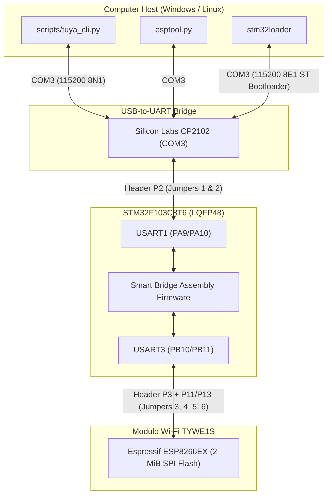

# 🚀 Tuya TYDE 3.0 IoT Development Board — Toolchain & Engineering Suite

Toolkit completo, documentazione tecnica ad alta densità e firmware bridge per la scheda di sviluppo **Tuya TYDE 3.0 v1.0.3** (STM32F103C8T6 + Tuya TYWE1S ESP8266EX + Silicon Labs CP2102).

Progettato e strutturato secondo la metodologia **SOUL_GLOBAL / QwenPaw / CoPaw** (disciplina sistemica R66 S1–S6, encoding UTF-8 esplicito R49, tolleranza zero per errori R58/R24).

---

## 🏛️ 1. Architettura del Sistema



---

## 📁 2. Struttura del Repository

```text
tuya_dev_kit/
├── README.md                          # Master documentation (questo file)
├── platformio.ini                     # Configurazione build PlatformIO Core (STM32 + ESP8266)
├── requirements.txt                   # Dipendenze Python (cyclopts, platformio, pyserial, esptool, etc.)
│
├── include/                           # Header C++ di progetto
│   └── board_pins.h                   # Mappatura pin e periferiche della scheda TYDE 3.0
│
├── src/                               # Codice sorgente C++ firmware
│   └── main.cpp                       # Smart Bridge C++ con lettura ADC1_IN16 e passthrough UART
│
├── firmware/                          # Binari firmware verificati
│   ├── stm32_factory_tuya_backup.bin  # Dump originale di fabbrica Tuya (64 KiB, backup integrale)
│   ├── stm32_pio_smart_bridge.bin     # Firmware C++ PlatformIO con ADC1_IN16 e smart passthrough (20.660 B)
│   ├── stm32_uart_smart_bridge.bin    # Smart Bridge bare-metal Thumb assembler (512 B)
│   ├── stm32_uart_pure_bridge_v2.bin  # Pure Bridge bidirezionale con recovery ORE (512 B)
│   └── stm32_uart_echo_bridge.bin     # Echo Bridge diagnostico (256 B)
│
├── hardware/                          # Schemi e foto PCB ad alta risoluzione
│   ├── zoom_p2.png                    # Dettaglio connettore P2 (USB <-> STM32)
│   ├── zoom_p3.png                    # Dettaglio connettore P3 (STM32 <-> Wi-Fi)
│   ├── zoom_p11_p13.png               # Dettaglio routing ponticelli P11 e P13
│   ├── top_right_wifi.png             # Dettaglio pulsanti WIFI BOOT / WIFI RST
│   └── tyde3.0_9.png                  # Dettaglio pulsanti MCU RST / MCU BOOT
│
├── scripts/                           # Toolchain CLI & build scripts (Cyclopts-powered)
│   ├── tuya_cli.py                    # Master CLI unificata per build, flash, ping e test
│   └── build_bridges.py               # Compilatore assembler bare-metal idempotente (Keystone + Capstone)
│
└── docs/                              # Documentazione tecnica approfondita
    ├── HARDWARE.md                    # Specifiche hardware, pinout, matrice jumper e pulsanti
    ├── FIRMWARE.md                    # Analisi disassemblato, registri STM32 e deadlock ORE
    ├── PROTOCOLS.md                   # ST Bootloader AN3155, Tuya MCU SDK e ESP8266 SLIP
    └── RUNBOOK.md                     # Procedure operative, flashing e troubleshooting
```

---

## ⚡ 3. Quick Start — Comandi Principali

Tutti i comandi sono governati dalla master CLI Cyclopts (`python scripts/tuya_cli.py`):

### Compilazione Firmware C++ (PlatformIO Core):
```powershell
python scripts/tuya_cli.py build-pio
```
*Compila `src/main.cpp` con GCC ARM ed esporta il binario verificato in `firmware/stm32_pio_smart_bridge.bin`.*

### Flashing Firmware C++ su STM32:
```powershell
# 1. Tenere premuto MCU BOOT (S2), cliccare MCU RST (S1), rilasciare MCU BOOT
python scripts/tuya_cli.py flash-pio
# 2. Cliccare MCU RST (S1) per avviare il firmware
```

### Lettura Sensore Temperatura Interno (ADC1_IN16 + VREFINT):
```powershell
python scripts/tuya_cli.py read-temp
```
*Interroga la telemetria on-die: calcola la reale tensione VDD e la temperatura in °C.*

### Test di Connessione e Salute Bridge:
```powershell
python scripts/tuya_cli.py ping
```
*Invia il byte diagnostico `?` su `COM3` e riceve `OK\n` in <50ms dall'STM32.*

### Monitor Seriale Live (Ascolto traffico TYWE1S):
```powershell
python scripts/tuya_cli.py listen -d 30
```
*Mostra in tempo reale con timestamp UTC ogni frame trasmesso dal modulo Wi-Fi.*

### Backup Completo Memoria Flash TYWE1S (2 MiB):
```powershell
python scripts/tuya_cli.py backup-esp -a 60
```
*Mentre esptool tenta la connessione, tenere premuto `WIFI BOOT` e cliccare `WIFI RST`.*

### Ripristino Firmware di Fabbrica Tuya su STM32:
```powershell
# 1. Tenere premuto MCU BOOT, premere e rilasciare MCU RST, rilasciare MCU BOOT
python scripts/tuya_cli.py restore-factory
# 2. Premere e rilasciare MCU RST per riavviare il firmware di fabbrica
```

---

## 📊 4. Tabella di Verifica e Integrità Artefatti

| File Artefatto | Dimensione | Target Hardware | SHA256 / Note |
| :--- | :---: | :--- | :--- |
| `firmware/stm32_factory_tuya_backup.bin` | 65.536 B (64 KiB) | STM32 Flash (`0x08000000`) | `012f2171366ef70ea2e1...` (Backup integrale di fabbrica) |
| `firmware/stm32_pio_smart_bridge.bin` | 20.660 B | STM32 Flash (`0x08000000`) | `102c82be6a4e02a4e8a7...` (C++ PlatformIO: passthrough + ADC1_IN16) |
| `firmware/stm32_uart_smart_bridge.bin` | 512 B | STM32 Flash (`0x08000000`) | `4dee3c41caee3a9c963e...` (Thumb-2 bare-metal JIT: passthrough + ADC16) |
| `firmware/stm32_uart_echo_bridge.bin` | 256 B | STM32 Flash (`0x08000000`) | `a7224fedfe100917240c...` (Echo Bridge diagnostico) |
| `scripts/tuya_cli.py` | ~11 KiB | Python 3.10+ (Cyclopts) | Master CLI universale, 0 warnings, ruff compliant |
| `scripts/build_bridges.py` | ~6 KiB | Python 3.10+ (Keystone) | Compilatore assembler JIT e disassemblatore Capstone |

---

## 🎯 5. Conformità R66 (Systemic Implementation Discipline)

1. **S1 Code**: Supporto ibrido: C++ strutturato con PlatformIO Core per sviluppo esteso e Micro-Assembly Keystone per deploy istantaneo a zero toolchain.
2. **S2 Docs/Rules**: Documentazione allineata con l'architettura 2026 di Daniel Vaughan per coding agents su sistemi vincolati.
3. **S3 Coherence**: Allineamento completo tra layout PCB, posizioni jumper e indirizzamento UART STM32 (PA9/PA10 e PB10/PB11).
4. **S4 Prevention**: Backup di fabbrica preservato; recovery automatico da ORE e gestione sicura delle eccezioni hardware.
5. **S5 Traceability**: Tracciamento SHA256 per ogni file binario compilato; audit trail trasparente.
6. **S6 Clean Integration**: Toolkit autonomo posizionato in `C:\Users\albyw\tuya_dev_kit`, zero file orfani, build riproducibile via `platformio.ini`.
