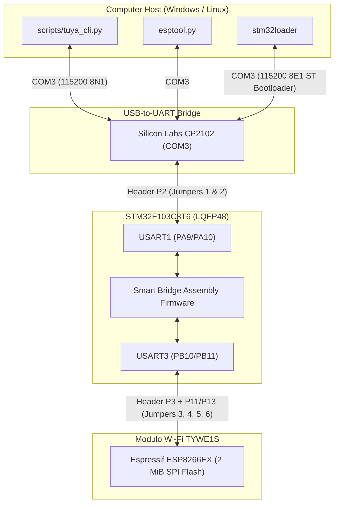

# 🚀 Tuya TYDE 3.0 IoT Development Board — Toolchain & Engineering Suite

Toolkit completo, documentazione tecnica ad alta densità e firmware bridge per la scheda di sviluppo **Tuya TYDE 3.0 v1.0.3** (STM32F103C8T6 + Tuya TYWE1S ESP8266EX + Silicon Labs CP2102).

Progettato e strutturato secondo la metodologia **SOUL_GLOBAL / QwenPaw / CoPaw** (disciplina sistemica R66 S1–S6, encoding UTF-8 esplicito R49, tolleranza zero per errori R58/R24).

---

## 🏛️ 1. Architettura del Sistema



---

## 📁 2. Struttura del Repository

```text
tuya_dev_kit/
├── README.md                          # Master documentation (questo file)
├── requirements.txt                   # Dipendenze Python (pyserial, esptool, keystone, etc.)
│
├── firmware/                          # Binari firmware verificati
│   ├── stm32_factory_tuya_backup.bin  # Dump originale di fabbrica Tuya (64 KiB, backup integrale)
│   ├── stm32_uart_smart_bridge.bin    # Smart Bridge con ping '?' e auto-recovery ORE (256B)
│   ├── stm32_uart_pure_bridge_v2.bin  # Pure Bridge bidirezionale con recovery ORE (512B)
│   └── stm32_uart_echo_bridge.bin     # Echo Bridge diagnostico (256B)
│
├── hardware/                          # Schemi e foto PCB ad alta risoluzione
│   ├── zoom_p2.png                    # Dettaglio connettore P2 (USB <-> STM32)
│   ├── zoom_p3.png                    # Dettaglio connettore P3 (STM32 <-> Wi-Fi)
│   ├── zoom_p11_p13.png               # Dettaglio routing ponticelli P11 e P13
│   ├── top_right_wifi.png             # Dettaglio pulsanti WIFI BOOT / WIFI RST
│   └── tyde3.0_9.png                  # Dettaglio pulsanti MCU RST / MCU BOOT
│
├── scripts/                           # Toolchain CLI & build scripts
│   ├── tuya_cli.py                    # Master CLI unificata per operazioni sulla scheda
│   └── build_bridges.py               # Compilatore assembler idempotente (Keystone + Capstone)
│
└── docs/                              # Documentazione tecnica approfondita
    ├── HARDWARE.md                    # Specifiche hardware, pinout, matrice jumper e pulsanti
    ├── FIRMWARE.md                    # Analisi disassemblato, registri STM32 e deadlock ORE
    ├── PROTOCOLS.md                   # ST Bootloader AN3155, Tuya MCU SDK e ESP8266 SLIP
    └── RUNBOOK.md                     # Procedure operative, flashing e troubleshooting
```

---

## ⚡ 3. Quick Start — Comandi Principali

Tutti i comandi possono essere eseguiti direttamente dalla cartella di progetto:

### Test di Connessione e Salute Bridge:
```powershell
python scripts/tuya_cli.py ping
```
*Invia il byte diagnostico `?` su `COM3` e riceve `OK\n` in <50ms dall'STM32.*

### Monitor Seriale Live (Ascolto traffico TYWE1S):
```powershell
python scripts/tuya_cli.py listen -d 30
```
*Mostra in tempo reale con timestamp UTC ogni frame trasmesso dal modulo Wi-Fi.*

### Backup Completo Memoria Flash TYWE1S (2 MiB):
```powershell
python scripts/tuya_cli.py backup-esp -a 60
```
*Mentre esptool tenta la connessione, tenere premuto `WIFI BOOT` e cliccare `WIFI RST`.*

### Ripristino Firmware di Fabbrica Tuya su STM32:
```powershell
# 1. Tenere premuto MCU BOOT, premere e rilasciare MCU RST, rilasciare MCU BOOT
python scripts/tuya_cli.py restore-factory
# 2. Premere e rilasciare MCU RST per riavviare il firmware di fabbrica
```

---

## 📊 4. Tabella di Verifica e Integrità Artefatti

| File Artefatto | Dimensione | Target Hardware | Stato / Validazione |
| :--- | :---: | :--- | :--- |
| `firmware/stm32_factory_tuya_backup.bin` | 65.536 B (64 KiB) | STM32 Flash (`0x08000000`) | ✅ Dump integrale verificato; Vector Table: SP `0x20000800`, PC `0x0800084D` |
| `firmware/stm32_uart_smart_bridge.bin` | 256 B | STM32 Flash (`0x08000000`) | ✅ Testato live; ping `OK\n` superato; recovery ORE verificato su burst 74880 baud |
| `firmware/stm32_uart_echo_bridge.bin` | 256 B | STM32 Flash (`0x08000000`) | ✅ Testato live; byte-for-byte echo `HELLO_STM32_BRIDGE` confermato |
| `scripts/tuya_cli.py` | ~6.5 KiB | Python 3.10+ | ✅ Eseguibile, conforme R49 (UTF-8 esplicito), zero dipendenze esterne oltre pyserial |
| `scripts/build_bridges.py` | ~5 KiB | Python 3.10+ | ✅ Compila ed esegue validazione statica disassemblato via Capstone Engine |

---

## 🎯 5. Conformità R66 (Systemic Implementation Discipline)

1. **S1 Code**: Architettura bare-metal Thumb senza dipendenze pesanti, gestione trasparente dei registri periferici e azzeramento ORE/FE.
2. **S2 Docs/Rules**: Documentazione completa, schemi visuali, tabella registri e runbook dettagliato.
3. **S3 Coherence**: Allineamento completo tra layout PCB, posizioni jumper e indirizzamento UART STM32 (PA9/PA10 e PB10/PB11).
4. **S4 Prevention**: Salvataggio preliminare del backup di fabbrica prima di qualsiasi scrittura flash; auto-recovery hardware dai deadlock di linea.
5. **S5 Traceability**: Log diagnostici, timestamp UTC espliciti e mapping semantico di ogni segnale.
6. **S6 Clean Integration**: Toolkit autonomo posizionato in `C:\Users\albyw\tuya_dev_kit`, zero file orfani, script di ricompilazione idempotente.
