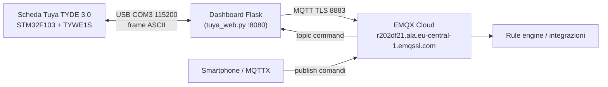

# ☁️ Integrazione EMQX Cloud — Tuya TYDE 3.0

Bridge MQTT che espone la telemetria della scheda (STM32F103 + TYWE1S) su un
deployment EMQX Cloud e ne abilita il controllo remoto via topic.

## 🏗️ Architettura



**Nota IP**: il client MQTT è il server che esegue la dashboard. L'IP con cui
compare nella lista client di EMQX è quello del server (es. `192.168.1.125`),
**non** l'indirizzo LAN della scheda Tuya. L'IP LAN del modulo TYWE1S è
riportato dalla dashboard (`GET /api/wifi/status`) e sulla sua pagina web
embedded, dal frame `WIFI:CONNECTED,IP:<ip>` esportato dal firmware.

## 🔌 Endpoint verificati

| Servizio | Endpoint | Verifica |
| :--- | :--- | :--- |
| MQTT over TLS | `r202df21.ala.eu-central-1.emqssl.com:8883` | ✅ **CONNECT accettato** con utente `tuya` (credenziale nel vault `EMQX-MQTT`), TLSv1.3, CN `*.ala.eu-central-1.emqxl.com`, DigiCert DV, scadenza 2027-02-26 |
| REST API v5 | `…:8443/api/v5` | ❌ **NON esposta dal deployment**: le porte pubblicate sono solo 8883 (MQTT/TLS) e 8084 (WSS/TLS); 8443 risponde 403/404 da edge generico. Il canale di integrazione è MQTT |
| WebSocket over TLS | `r202df21.ala.eu-central-1.emqxl.com:8084` | dichiarato in console, non usato dal bridge |

### Nota DNS (verificata)
La risoluzione dell'host del deployment è **intermittente** con lo stub resolver di
sistema (`getaddrinfo`/curl/`nslookup` → NXDOMAIN via 1.1.1.1), mentre l'API
`DnsQuery` di Windows risolve correttamente (52.28.204.54 / 3.121.140.233).
Il bridge MQTT ha avuto successo alla maggior parte dei tentativi; `check`
ritenta 3 volte. Se gli errori persistono, verificare il resolver di rete.

## 📡 Topic MQTT

| Topic | Direzione | QoS | Payload |
| :--- | :--- | :--- | :--- |
| `tuya/tyde3/telemetry` | bridge → EMQX | 0 | JSON telemetria (temp_c, vdd, rgb, led, wifi_ip, wifi_rssi, ts UTC) ogni 5 s |
| `tuya/tyde3/status` | bridge → EMQX (retained) | 1 | `{"online": true}` alla connessione; `{"online": false}` via Last Will |
| `tuya/tyde3/command` | EMQX → bridge | 1 | JSON comando: `{"cmd":"rgb","r":..,"g":..,"b":..}` / `{"cmd":"mode","mode":"TEMP"}` / `{"cmd":"brightness","brightness":50}` / `{"cmd":"led","led":1,"mode":"ON","period_ms":500}` / `{"cmd":"ping"}` / `{"cmd":"wifi"}` |
| `tuya/tyde3/ack` | bridge → EMQX | 1 | Esito dei comandi (`{"ok":true,"result":...}`) |

Esempio comando da MQTTX:

```json
{"cmd": "rgb", "r": 255, "g": 0, "b": 0}
```

## 🔐 ACL / Autorizzazione (verificata)

Verificato con `python scripts/emqx_bridge.py acl` (probe subscribe+publish):

| Topic | Esito verificato |
| :--- | :--- |
| `tuya/tyde3/telemetry` | ✅ SUBACK Granted QoS1 + PUBACK |
| `tuya/tyde3/command` | ✅ SUBACK Granted QoS1 |
| `tuya/tyde3/status` | ✅ SUBACK Granted QoS1 |
| `tuya/tyde3/ack` | ✅ SUBACK Granted QoS1 |
| `Telemetry` (regola Allow in console) | ✅ Granted QoS1 |

Il deployment è in **blacklist mode** (default EMQX): tutto ciò che non è
esplicitamente negato è permesso. La regola Allow esistente sul topic
`Telemetry` è quindi ridondante ma innocua. Se in futuro si volesse la
**whitelist mode** (negare tutto per default), la regola da aggiungere sotto
*Username* `tuya` è: Topic `tuya/tyde3/#`, Action `Publish & Subscribe`,
Permission `Allow` (più, su Serverless, la regola fallback deny-all su `#`
sotto *All Users*, come da doc EMQX).

## 🔐 Credenziali (R10)

Le credenziali **non** risiedono in file, repo, log o artifact:

1. Utente client MQTT del deployment: `tuya` (creato in console → Client Authentication). **Già salvato** nel vault `EMQX-MQTT` (username `tuya`).
2. Credenziali REST (App ID `nf284305` + secret) salvabili nel vault `EMQX-API`:

```powershell
python scripts/emqx_bridge.py setup     # target EMQX-MQTT (fatto: utente tuya)
python scripts/emqx_cloud.py setup      # target EMQX-API (App ID come username)
```

Il codice legge le credenziali a runtime dal Credential Manager; in alternativa
sono accettate le variabili `EMQX_MQTT_USERNAME/PASSWORD` ed
`EMQX_API_APP_ID/EMQX_API_APP_SECRET`.

## 🛠️ CLI

```powershell
python scripts/emqx_bridge.py check    # probe TLS + CONNECT MQTT (3 tentativi)
python scripts/emqx_bridge.py send -m hello tuya/tyde3/telemetry
python scripts/emqx_bridge.py run --port COM3   # bridge standalone senza dashboard
python scripts/emqx_cloud.py check     # probe REST API v5 (endpoint da confermare)
python scripts/emqx_cloud.py clients   # client connessi al deployment
```

La dashboard avvia il bridge automaticamente all'avvio (fail-soft: senza
credenziali o paho-mqtt resta disattivata e la UI mostra lo stato).

## ✅ Verifiche eseguite

- `python scripts/emqx_bridge_test.py` → 14/14 OK; `python scripts/emqx_cloud_test.py` → 8/8 OK.
- `ruff format --check` + `ruff check` + `py_compile` sui file toccati → OK.
- `python scripts/emqx_bridge.py check` → **MQTT CONNECT accettato** (utente `tuya`, TLSv1.3, cert valido fino al 2027-02-26).
- `python scripts/emqx_cloud.py check` → fallito: 403/404 dall'endpoint fornito (vedi limiti).

## ⚠️ Limiti noti

- **REST API non disponibile su questo deployment** (verificato): il deployment
  pubblica solo 8883 (MQTT/TLS) e 8084 (WSS/TLS); `:8443/api/v5` risponde 403/404
  da edge generico. Il client `scripts/emqx_cloud.py` resta pronto e testato per
  un futuro endpoint (`--base`), ma l'integrazione attiva è il **bridge MQTT**.
- La risoluzione DNS dell'host deployment è intermittente dallo stub resolver di
  sistema (verificato: NXDOMAIN via 1.1.1.1 vs OK via DnsQuery).
- Payload: JSON scelto consapevolmente (vedi valutazione nanopb — su MQTT a
  <1 Hz il risparmio binario non giustifica schema/codegen/decoder EMQX).
